# Entity relationships

Each section of the dictionary states the grain. Solid mandatory FK references have
one parent; nullable FK columns have zero or one parent. Parent-to-child counts are 0..N
unless the business rules constrain them (one default address; at most one captured payment).

```mermaid
erDiagram
    customers {
        id customer_id PK
        text customer_name
        text email
        text phone
        timestamp registered_at
        timestamp inactive_at
        text status
        text acquisition_channel
        text spending_segment
    }
    customer_addresses {
        id address_id PK
        id customer_id FK
        text province
        text district
        text address_line
        text postal_code
        bool is_default
    }
    customers ||--o{ customer_addresses : "customer_id"
    sellers {
        id seller_id PK
        text seller_name
        text seller_type
        timestamp registered_at
        text province
        text status
        id warehouse_id FK
    }
    warehouses ||--o{ sellers : "warehouse_id"
    categories {
        id category_id PK
        text category_name
        id parent_category_id FK
        int category_level
    }
    categories |o--o{ categories : "parent_category_id"
    products {
        id product_id PK
        id seller_id FK
        id category_id FK
        text brand
        text product_name
        money unit_cost
        json attributes
        timestamp launched_at
        timestamp discontinued_at
        bool is_active
    }
    sellers ||--o{ products : "seller_id"
    categories ||--o{ products : "category_id"
    product_price_history {
        id price_history_id PK
        id product_id FK
        timestamp effective_from
        timestamp effective_to
        money listed_price
        money promotional_price
        text change_reason
    }
    products ||--o{ product_price_history : "product_id"
    orders {
        id order_id PK
        id customer_id FK
        id address_id FK
        timestamp ordered_at
        text sales_channel
        text status
        text currency
        money item_gmv
        money line_discount
        money order_discount
        money shipping_fee
        money total_payable
        id campaign_id FK
    }
    customers ||--o{ orders : "customer_id"
    customer_addresses ||--o{ orders : "address_id"
    marketing_campaigns |o--o{ orders : "campaign_id"
    order_items {
        id order_item_id PK
        id order_id FK
        id product_id FK
        id seller_id FK
        int quantity
        money unit_price
        money item_gmv
        money line_discount
        money allocated_order_discount
        money item_amount
    }
    orders ||--o{ order_items : "order_id"
    products ||--o{ order_items : "product_id"
    sellers ||--o{ order_items : "seller_id"
    order_status_history {
        id status_event_id PK
        id order_id FK
        text previous_status
        text new_status
        timestamp event_at
        text source_system
        text change_reason
    }
    orders ||--o{ order_status_history : "order_id"
    coupons {
        id coupon_id PK
        id campaign_id FK
        text coupon_code
        text discount_type
        int discount_value
        money minimum_spend
        money maximum_discount
        id category_id FK
        timestamp starts_at
        timestamp ends_at
        int redemption_limit
    }
    marketing_campaigns |o--o{ coupons : "campaign_id"
    categories |o--o{ coupons : "category_id"
    order_discounts {
        id order_discount_id PK
        id order_id FK
        id coupon_id FK
        text allocation_method
        money discount_amount
    }
    orders ||--o{ order_discounts : "order_id"
    coupons ||--o{ order_discounts : "coupon_id"
    payments {
        id payment_id PK
        id order_id FK
        text provider
        text method
        int attempt_number
        text status
        timestamp attempted_at
        timestamp authorized_at
        timestamp captured_at
        money amount
        text failure_code
    }
    orders ||--o{ payments : "order_id"
    refunds {
        id refund_id PK
        id payment_id FK
        id order_id FK
        id return_id FK
        money requested_amount
        money refunded_amount
        text status
        timestamp requested_at
        timestamp refunded_at
    }
    payments ||--o{ refunds : "payment_id"
    orders ||--o{ refunds : "order_id"
    returns |o--o{ refunds : "return_id"
    warehouses {
        id warehouse_id PK
        text warehouse_name
        text province
        text warehouse_type
        text status
    }
    inventory_movements {
        id movement_id PK
        id product_id FK
        id warehouse_id FK
        text movement_type
        int quantity_delta
        int reserved_delta
        text reference_type
        id reference_id
        timestamp event_at
        text reason
    }
    products ||--o{ inventory_movements : "product_id"
    warehouses ||--o{ inventory_movements : "warehouse_id"
    shipments {
        id shipment_id PK
        id order_id FK
        id seller_id FK
        id warehouse_id FK
        text delivery_partner
        money shipping_fee
        text status
        timestamp created_at
        timestamp shipped_at
        timestamp expected_delivery_at
        timestamp delivered_at
        timestamp closed_at
        int sla_days
    }
    orders ||--o{ shipments : "order_id"
    sellers ||--o{ shipments : "seller_id"
    warehouses ||--o{ shipments : "warehouse_id"
    shipment_items {
        id shipment_item_id PK
        id shipment_id FK
        id order_item_id FK
        int quantity
    }
    shipments ||--o{ shipment_items : "shipment_id"
    order_items ||--o{ shipment_items : "order_item_id"
    shipment_events {
        id shipment_event_id PK
        id shipment_id FK
        timestamp event_at
        text event_type
        text event_location
        int event_sequence
    }
    shipments ||--o{ shipment_events : "shipment_id"
    returns {
        id return_id PK
        id order_id FK
        id order_item_id FK
        int requested_quantity
        text reason
        timestamp requested_at
        timestamp received_at
        text status
        text outcome
    }
    orders ||--o{ returns : "order_id"
    order_items ||--o{ returns : "order_item_id"
    marketing_campaigns {
        id campaign_id PK
        text campaign_name
        text objective
        text channel
        timestamp starts_at
        timestamp ends_at
        money budget
    }
    marketing_spend_daily {
        id spend_id PK
        id campaign_id FK
        date spend_date
        text channel
        money spend_amount
        int impressions
        int clicks
    }
    marketing_campaigns ||--o{ marketing_spend_daily : "campaign_id"
    web_events {
        id event_id PK
        text anonymous_visitor_id
        text session_id
        id customer_id FK
        text event_type
        timestamp event_at
        id product_id FK
        text device_type
        text traffic_source
        id campaign_id FK
        json properties
    }
    customers |o--o{ web_events : "customer_id"
    products |o--o{ web_events : "product_id"
    marketing_campaigns |o--o{ web_events : "campaign_id"
    reviews {
        id review_id PK
        id customer_id FK
        id product_id FK
        id order_item_id FK
        int rating
        timestamp reviewed_at
        text review_text
    }
    customers ||--o{ reviews : "customer_id"
    products ||--o{ reviews : "product_id"
    order_items ||--o{ reviews : "order_item_id"
    support_tickets {
        id ticket_id PK
        id customer_id FK
        id order_id FK
        text issue_category
        text priority
        timestamp created_at
        timestamp first_response_at
        timestamp resolved_at
        text status
    }
    customers ||--o{ support_tickets : "customer_id"
    orders |o--o{ support_tickets : "order_id"
```

`inventory_movements.reference_id` is a documented polymorphic reference to products, order_items or returns.
`web_events.properties.order_id` is a semi-structured purchase reference, validated separately.